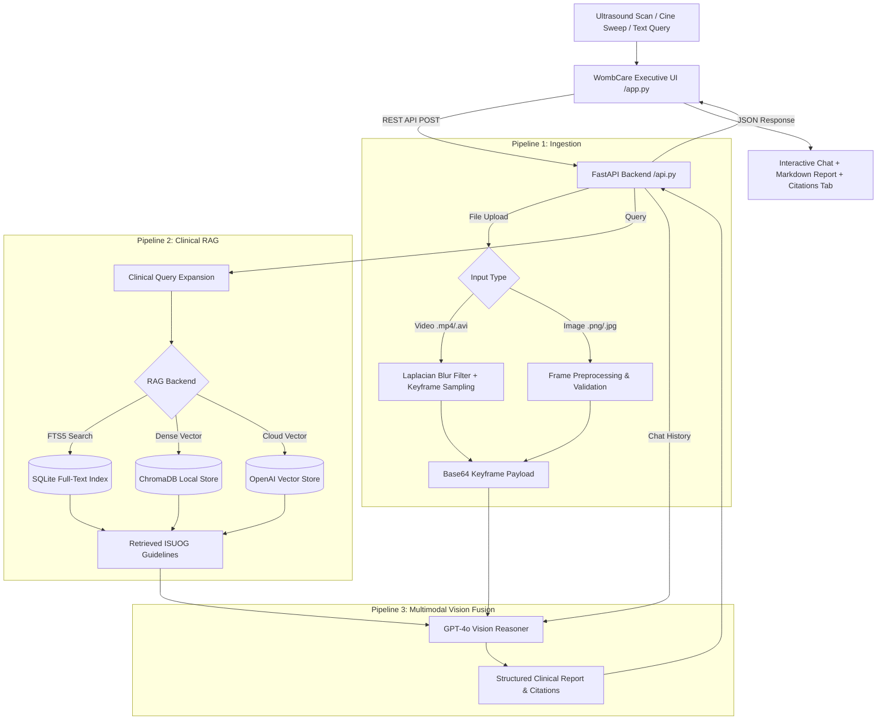

<div align="center">


# WombCare · Fetal Ultrasound Intelligence & Pregnancy Support

**Clinical Multimodal AI for Fetal Sonography, Pelvic Scan Triage & Evidence-Grounded Maternal Health**

[](https://www.python.org/)
[](https://fastapi.tiangolo.com/)
[](https://streamlit.io/)
[](https://openai.com/)
[](https://www.isuog.org/)
[](#-license)

</div>

---

## 🌸 Overview

**WombCare** is an executive multimodal medical AI dashboard engineered for fetal ultrasound screening, pelvic scan classification, and maternal pregnancy consultation. Grounded strictly in the **ISUOG 2023 Practice Guidelines** (*International Society of Ultrasound in Obstetrics and Gynecology*), WombCare couples **GPT-4o Multimodal Vision** with **Retrieval-Augmented Generation (RAG)** across a curated corpus of 1,520 clinical ultrasound records.

Whether evaluating static scans, dynamic cine-loop video sweeps, or clinical text consultations, WombCare delivers immediate diagnostic classification, structured anatomical checklists, plane evaluations, and cited clinical evidence.

---

## 🌟 Key Capabilities

### 1. Definitive Diagnostic Triage
- 🤰 **Gravid (Pregnancy Detected)**: Rapidly identifies intrauterine gestational sacs, double decidual signs, yolk sacs, embryonic poles, cardiac flickers, fetal anatomy (cranial, cardiac, spinal, abdominal), and placental attachments.
- 🩺 **Non-Gravid (Pelvic Anatomy)**: Identifies nongravid pelvic morphology (homogeneous myometrium, regular endometrial stripes, ovarian parenchyma, absence of intrauterine or ectopic gestational sacs).
- ⚠️ **Indeterminate / PUL**: Identifies equivocal fluid collections, pseudogestational sacs, or early pregnancies of unknown location (PUL), issuing instant directives for quantitative serum $\beta$-hCG correlation and repeat transvaginal sonography (TVS).

### 2. Multimodal Ultrasound Ingestion (Pipeline 1)
- Supports static scans (`.png`, `.jpg`, `.jpeg`) and ultrasound video cine-loops (`.mp4`, `.avi`, `.mov`).
- Employs **Variance-of-Laplacian blur filtering** combined with uniform temporal sampling to automatically extract the highest-clarity acoustic keyframes.

### 3. ISUOG 2023 Clinical RAG (Pipeline 2)
- Indexed against the official ISUOG Practice Guidelines (Carvalho et al., 2023) and the structured `rag-only/` clinical corpus (1,520 ultrasound records, 1,445 evidence excerpts, 68 cited guidelines).
- **Hybrid Retrieval Backends**:
  - **SQLite FTS5 Full-Text Search**: Instant zero-latency search with zero API cost.
  - **ChromaDB Vector Store**: Local embedding retrieval for offline/dev environments.
  - **OpenAI Cloud Vector Store**: Enterprise assistant-grade cloud retrieval.
- Context-aware clinical query expansion and strict citation tracking (`[Guideline 1]`, `[Guideline 2]`).

### 4. Multimodal Fusion & Structured Reports (Pipeline 3)
- Fuses sampled keyframes with retrieved clinical literature into a structured prompt for **GPT-4o**.
- Emits structured medical assessment reports:
  - Classification banner (Gravid / Non-Gravid / Indeterminate).
  - Anatomical breakdown and checklist.
  - Plane optimization & acoustic quality evaluation.
  - Clinical interpretations with guideline citations.
  - Recommended follow-up steps.

### 5. Multi-Turn Interactive Consultation & Text Inquiries
- Supports both scan uploads and text-only queries (e.g., gestational age calculation, amniotic fluid evaluation, ectopic risk factors).
- Context-preserving session memory for multi-turn follow-up queries.

### 6. Executive WombCare Frontend & Theme Guarantee
- Redesigned with the **WombCare Design System**: warm rose/blush palette, high-contrast typography, and soft card styling.
- Hardened with explicit CSS and `.streamlit/config.toml` light-theme enforcement to eliminate dark-mode text washout and ensure 100% legibility across all browsers.
- Multi-tab layout: **💬 Consultation Chat**, **📋 Assessment Report** (with 1-click `.md` and `.json` export), **📚 Guidelines Inspector**, and **🔬 Session Diagnostics**.

---

## 🏗️ System Architecture



---

## 📁 Repository Structure

```text
├── .streamlit/
│   └── config.toml               # Streamlit theme enforcement (light mode, ink tokens)
├── rag-only/                     # 1,520 curated clinical ultrasound knowledge base records
├── static/
│   └── logo.jpeg                 # Static assets directory
├── api.py                        # FastAPI production REST backend
├── app.py                        # Streamlit executive medical dashboard
├── index_rag.py                  # Knowledge base indexer (FTS5 / ChromaDB / OpenAI)
├── logo.jpeg                     # Official WombCare logo
├── pipeline1_ingestion.py        # Cine-loop sampling and image validation
├── pipeline2_rag.py              # Clinical RAG retrieval & query expansion
├── pipeline3_fusion.py           # GPT-4o multimodal prompt fusion & inference
├── requirements.txt              # Production Python dependencies
├── env.example                   # Environment variable template
├── .env                          # Local credentials (ignored by git)
└── README.md                     # Project documentation
```

---

## 📋 Prerequisites

- **Python**: 3.10, 3.11, or 3.12
- **OpenAI API Key** with GPT-4o access
- **OS**: Windows, macOS, or Linux

---

## 🚀 Quickstart Guide

### 1. Clone the Repository

```bash
git clone https://github.com/vis-hal-git/EchoAI-Pregnancy-Support-Ultrasound-Intelligence.git
cd EchoAI-Pregnancy-Support-Ultrasound-Intelligence
```

### 2. Set Up Virtual Environment

```bash
# Windows (PowerShell)
python -m venv venv
.\venv\Scripts\activate

# macOS / Linux
python3 -m venv venv
source venv/bin/activate
```

### 3. Install Dependencies

```bash
pip install -r requirements.txt
```

### 4. Configure Environment Variables

Copy `env.example` to `.env`:

```bash
# Windows (PowerShell)
Copy-Item env.example .env

# macOS / Linux
cp env.example .env
```

Edit `.env` with your OpenAI credentials:

```env
OPENAI_API_KEY=sk-proj-...
OPENAI_VECTOR_STORE_ID=       # Optional: leave empty to use local FTS/ChromaDB
API_URL=http://localhost:8000
GPT_MODEL=gpt-4o
DEFAULT_K_FRAMES=8
```

### 5. Verify / Index Knowledge Base

Verify the pre-built clinical knowledge index:

```bash
# Instant SQLite FTS5 index (0 API cost, recommended for instant startup)
python index_rag.py --backend fts

# Optional: Index into persistent ChromaDB vector store
python index_rag.py --backend local

# Optional: Upload to OpenAI Cloud Vector Store
python index_rag.py --backend openai
```

---

## 🖥️ Running WombCare

Running WombCare requires starting both the backend API and the frontend dashboard:

### Terminal 1: Backend API (FastAPI)

```bash
.\venv\Scripts\activate
uvicorn api:app --host 127.0.0.1 --port 8000 --reload
```

- **Base URL**: `http://localhost:8000`
- **Interactive Swagger Docs**: `http://localhost:8000/docs`
- **Health Check**: `http://localhost:8000/health`

### Terminal 2: Frontend Dashboard (Streamlit)

```bash
.\venv\Scripts\activate
streamlit run app.py --server.port 8501
```

- **Web Dashboard**: `http://localhost:8501`

---

## 📡 REST API Reference

| Method | Endpoint | Description | Payload / Parameters |
| :--- | :--- | :--- | :--- |
| `GET` | `/health` | Backend liveness and health probe | None |
| `POST` | `/analyze` | Primary multimodal analysis & consultation | `file` (optional scan/video), `query` (string), `k` (int, default 8) |
| `POST` | `/chat` | Multi-turn conversational follow-up | `session_id` (UUID), `follow_up` (string), `k` (int) |
| `GET` | `/session/{id}/citations` | Retrieve citations linked to a session | Path parameter `id` |
| `DELETE` | `/session/{id}` | Clean up and free active session memory | Path parameter `id` |

### Sample Analysis Request (cURL)

```bash
curl -X POST "http://localhost:8000/analyze" \
     -F "file=@sample_scan.png" \
     -F "query=Classify this scan: is pregnancy detected or non-gravid? Detail all visible landmarks." \
     -F "k=8"
```

---

## 🌸 Clinical Reference Standards

WombCare encodes and grounds assessments in established clinical obstetrics:

### First Trimester Milestones (5–12 Weeks)
- **4.5–5 Weeks**: Intrauterine gestational sac embedded within decidua (double decidual sign).
- **5–5.5 Weeks**: Yolk sac confirmation (excludes pseudogestational sac).
- **6–6.5 Weeks**: Fetal pole identification and embryonic cardiac pulsatility (>100 bpm).
- **7–12 Weeks**: Crown-Rump Length (CRL) dating accuracy within $\pm 3\text{--}5$ days.
- **11–13+6 Weeks**: Nuchal Translucency (NT) screening parameters.

### Second Trimester Screening (18–22 Weeks)
- **ISUOG 5-Plane Fetal Echocardiography**:
  1. Abdominal Situs & Stomach Axis
  2. Four-Chamber View (4CV, 45° cardiac axis)
  3. Left Ventricular Outflow Tract (LVOT)
  4. Right Ventricular Outflow Tract (RVOT)
  5. Three-Vessel & Trachea View (3VT)
- **Biometry**: BPD, HC, AC, FL, and estimated fetal weight (EFW).

### Third Trimester Surveillance (28–40 Weeks)
- **Amniotic Fluid**: Single Deepest Pocket (SDP: $2\text{--}8\text{ cm}$) and Amniotic Fluid Index (AFI: $5\text{--}25\text{ cm}$).
- **Placenta & Doppler**: Placental localization, retroplacental clear zone, and umbilical artery Doppler indices.

---

## 🛡️ Disclaimer

> [!IMPORTANT]
> **Investigational and Clinical Decision-Support Tool Only.**
> WombCare is designed for research, educational, and assistive clinical reference purposes. It does not replace the formal diagnostic evaluation or medical judgment of certified sonographers, obstetricians, radiologists, or maternal-fetal medicine specialists. Always corroborate ultrasound findings with direct clinical examination, laboratory testing (including serum $\beta$-hCG), and institutional imaging protocols.

---

## 📄 License

This project is licensed under the [MIT License](LICENSE).
