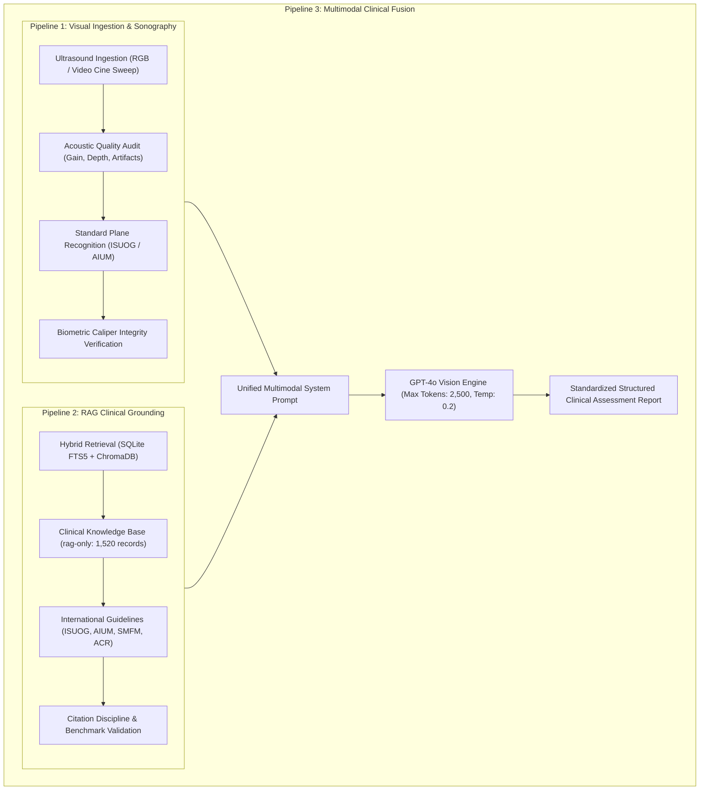

<div align="center">


# WombCare · Fetal Ultrasound Intelligence & Pregnancy Support

**Clinical Multimodal AI for Fetal Sonography, Pelvic Scan Triage & Evidence-Grounded Maternal Health**

[](https://www.python.org/)
[](https://fastapi.tiangolo.com/)
[](https://streamlit.io/)
[](https://openai.com/)
[-e91e8c.svg)](#-curated-clinical-rag-pipeline-2)
[](#-clinical-system-prompt-architecture)
[](#-license)

</div>

---

## 🌸 Overview

**WombCare** is an executive-grade multimodal medical AI system engineered for obstetric ultrasound screening, gynecological pelvic scan classification, and maternal pregnancy consultation. Grounded strictly in the **`rag-only` clinical ultrasound dataset** (1,520 curated records, 1,445 evidence excerpts, and 68 primary medical papers), WombCare couples **GPT-4o Multimodal Vision** with **hybrid Retrieval-Augmented Generation (RAG)**.

Whether evaluating static 2D/3D scans (`.png`, `.jpg`, `.jpeg`), dynamic cine-loop video sweeps (`.mp4`, `.avi`), or natural-language pregnancy consultations, WombCare provides:
- **Instant Diagnostic Triage**: Gravid (`PREGNANCY DETECTED`), Non-Gravid (`NON-PREGNANT`), or Indeterminate (`PUL / Early Correlation`).
- **Standard Screening Plane Verification**: Neurosonogram axial planes, 5-plane ISUOG cardiac screening, facial profile/lips, spine alignment, abdominal circumference, renal fossae, and femur length diaphysis.
- **Biometric Caliper Integrity & Validation**: Verification of caliper landmarks (outer-to-inner BPD, outer ellipse HC/AC, diaphyseal FL excluding epiphyses, inner-to-inner NT).
- **Evidence-Grounded Reports**: Complete anatomical checklists and clinical recommendations with in-text citations (`[Record X]`, `[Guideline: Authors, Year]`).

---

## 🌟 Key Capabilities

### 1. Definitive Diagnostic Classification
- 🤰 **Gravid (Pregnancy Detected)**: Identifies intrauterine gestational sacs, double decidual sac sign (DDSS), yolk sacs, embryonic poles with cardiac activity, and comprehensive second/third-trimester fetal organ systems.
- 🩺 **Non-Gravid (Pelvic Anatomy)**: Confirms normal or pathological non-gravid pelvic morphology (uterine size/axis, regular endometrial stripe, functional ovarian parenchyma, O-RADS cysts/masses, absence of intrauterine or ectopic gestational structures).
- ⚠️ **Indeterminate / PUL**: Detects equivocal intrauterine fluid, pseudo-gestational sacs, or early pregnancies of unknown location (PUL), issuing immediate directives for quantitative serum $\beta$-hCG correlation and scheduled repeat transvaginal sonography (TVS).

### 2. One-Click Upload to Detailed Report Workflow
- **Streamlined User Experience**: Select any ultrasound image or video file and click **"🌸 Upload & Generate Report"**.
- **Immediate Report Generation**: Automatically queries the clinical knowledge base, processes keyframes, and opens directly in **Tab 1: 📋 Detailed Assessment Report**.
- **Interactive Multi-Turn Consultation**: Seamlessly ask follow-up questions in **Tab 2: 💬 Consultation & Follow-up** with continuous session memory.
- **Evidence Inspector & Telemetry**: Review retrieved clinical records in **Tab 3** and inspect backend latency/token metrics in **Tab 4**.

### 3. Curated Clinical Knowledge Base (`rag-only`)
- 1,520 curated fetal ultrasound records organized across:
  - `views.jsonl`: Standard anatomical planes, probe positioning, and acoustic landmarks.
  - `findings.jsonl`: Sonographic features, biometric measurements, and diagnostic markers.
  - `workflows.jsonl`: Step-by-step screening sequences and triage protocols.
  - `diseases.jsonl`: Congenital heart defects, neural tube defects, skeletal dysplasias, and early pregnancy complications.
  - `cases.jsonl`: Verified clinical presentations and sonographic correlations.
  - `media.jsonl`: Figure evidence and clinical scan annotations.
- **Hybrid Multi-Backend Retrieval**:
  - **SQLite FTS5 Full-Text Search**: Instant local BM25 ranking across records, evidence, and guideline citations.
  - **ChromaDB Vector Store**: Persistent semantic vector search with `text-embedding-3-small`.
  - **OpenAI Cloud Vector Store**: Production enterprise vector store via OpenAI Files API.

---

## 🧬 Clinical System Prompt Architecture

WombCare implements a modular, clinically rigorous prompt architecture aligned with international ultrasound screening standards:



### 1. Vision System Prompt (`VISION_SYSTEM_PROMPT`)
- **Acoustic & Technical Audit**: Evaluates transducer frequency (curvilinear 3.5–5.0 MHz transabdominal vs. 5.0–9.0 MHz transvaginal), gain uniformity, focal depth, and acoustic phenomena (posterior enhancement, acoustic shadowing, reverberation, side-lobe artifacts).
- **Standard Anatomic Plane Identification**:
  - **First Trimester**: Gestational sac (MSD with DDSS), Crown-Rump Length (CRL mid-sagittal section in neutral posture), Nuchal Translucency (NT mid-sagittal section magnified >75%, inner-to-inner calipers).
  - **Second Trimester Neurosonogram (3 Axial Planes)**:
    1. *Transventricular (TV)*: Frontal horns, midline falx, CSP, ventricular atrium (<10.0 mm).
    2. *Transthalamic (TT)*: Paired thalami, box-shaped CSP, ambient cisterns (BPD and HC).
    3. *Transcerebellar (TC)*: Symmetrical cerebellar hemispheres (dumbbell/peanut shape), vermis, cisterna magna (2.0–10.0 mm), nuchal fold (<6.0 mm).
  - **Facial Views**: Mid-sagittal profile (nasal bone ossification, micrognathia screening), coronal upper lip and nostrils (cleft lip/palate).
  - **Fetal Spine**: Sagittal (intact skin line, sacral tapering), axial transverse (3 ossification centers forming closed ring), coronal (parallel vertebral alignment).
  - **The 5-Plane ISUOG Cardiac Screening Protocol**:
    1. *Plane 1 (Situs & Stomach)*: Left-sided stomach bubble, descending aorta left of spine, IVC right.
    2. *Plane 2 (4CV - Four-Chamber View)*: Cardiac axis 45° ± 20° left, heart ~1/3 of thorax, equal atria/ventricles, patent foramen ovale flap in LA, intact ventricular septum, differential AV valve insertion.
    3. *Plane 3 (LVOT)*: Aortic root from left ventricle, unbroken aortic-mitral continuity.
    4. *Plane 4 (RVOT)*: Main pulmonary artery from right ventricle crossing anterior to aorta, bifurcation into branch pulmonary arteries.
    5. *Plane 5 (3VT - Three-Vessel & Trachea View)*: PA > Ao > SVC, V-shaped arch convergence to the left of the trachea.
  - **Abdomen & Biometry**: Transverse AC plane at J-shaped portal sinus and stomach bubble (kidneys absent), bilateral renal fossae, fluid-filled bladder.
  - **Extremities**: Femur length (FL) measured along ossified diaphysis perpendicular to the beam.
  - **Gynecologic Planes**: Midline sagittal uterus (double-layer endometrium, junctional zone), bilateral ovaries (follicles, stroma, cysts per O-RADS), pouch of Douglas free fluid.
- **Biometric Caliper Integrity**: Rejects off-axis sections; validates outer-to-inner BPD, outer calvarial HC, outer skin-to-skin AC, and diaphyseal FL excluding epiphyses.

### 2. RAG System Prompt (`RAG_SYSTEM_PROMPT`)
- **Evidence Grounding**: Strictly constrains diagnostic reasoning to the retrieved `rag-only` clinical records.
- **In-Text Citation Mandate**: Requires `[Record X]` citations for every diagnostic criterion, normal range, and recommendation.
- **Validated Clinical Thresholds**:
  - Early Pregnancy Viability: MSD $\ge 25\text{ mm}$ without embryo = anembryonic pregnancy; CRL $\ge 7\text{ mm}$ without heartbeat = embryonic demise.
  - Ventriculomegaly: $<10.0\text{ mm}$ normal; $10.0\text{--}12.0\text{ mm}$ mild; $12.1\text{--}15.0\text{ mm}$ moderate; $>15.0\text{ mm}$ severe.
  - Cisterna Magna: $2.0\text{--}10.0\text{ mm}$ normal; $<2.0\text{ mm}$ effaced (Chiari II / open spina bifida).
  - Nuchal Fold: $<6.0\text{ mm}$ at 18–22 weeks.
  - Renal Pelvis AP Diameter: $<4.0\text{ mm}$ ($<20\text{w}$), $<7.0\text{ mm}$ ($20\text{--}30\text{w}$), $<10.0\text{ mm}$ (3rd trimester).
  - Amniotic Fluid: Single Deepest Pocket (SDP: $2.0\text{--}8.0\text{ cm}$), Amniotic Fluid Index (AFI: $5.0\text{--}25.0\text{ cm}$).
  - Cervical Length: $>25\text{ mm}$ normal on TVS.
- **Risk Stratification**: Differentiates benign isolated soft markers (e.g., isolated choroid plexus cyst, echogenic intracardiac focus) from complex structural anomalies.

### 3. Unified Multimodal Fusion Prompt (`SYSTEM_PROMPT`)
- Fuses Vision and RAG into an executive clinical decision-support consultant.
- Uses an expanded token budget (`MAX_TOKENS = 2500`) and low temperature (`TEMPERATURE = 0.2`) for deterministic medical reporting.
- Produces a structured 8-part clinical report:
  1. Executive Status Banner (`🤰 PREGNANCY DETECTED` | `🩺 NON-PREGNANT` | `⚠️ INDETERMINATE / PUL`).
  2. Scan Classification & Acoustic Plane Verification.
  3. Primary Visual Evidence.
  4. Anatomical Findings & Screening Checklist.
  5. Biometric Summary Table with Gestational Age Equivalents.
  6. Clinical Interpretation & Guideline Synthesis (`[Record 1]`, `[Record 2]`).
  7. Findings of Concern & Differential Considerations.
  8. Actionable Clinical Recommendations & Clinical Support Notice.

---

## 📁 Repository Structure

```text
├── .streamlit/
│   └── config.toml               # Streamlit theme enforcement (light mode, ink tokens)
├── rag-only/                     # 1,520 curated clinical ultrasound knowledge base records
│   ├── indexes/
│   │   └── kb.sqlite             # Pre-built SQLite FTS5 search index
│   └── records/
│       ├── views.jsonl           # Standard anatomical planes and acoustic landmarks
│       ├── findings.jsonl        # Sonographic features and diagnostic criteria
│       ├── workflows.jsonl       # Screening workflows and clinical protocols
│       ├── diseases.jsonl        # Congenital anomalies and pelvic pathologies
│       ├── cases.jsonl           # Verified clinical cases
│       ├── media.jsonl           # Figure annotations and scan metadata
│       ├── evidence.jsonl        # 1,445 cited clinical evidence excerpts
│       └── sources.jsonl         # 68 primary clinical publications & guidelines
├── static/
│   └── logo.jpeg                 # Official logo asset for web serving
├── api.py                        # FastAPI production REST backend
├── app.py                        # Streamlit executive medical dashboard
├── index_rag.py                  # Knowledge base indexer (FTS5 / ChromaDB / OpenAI)
├── logo.jpeg                     # Official WombCare logo
├── pipeline1_ingestion.py        # Cine-loop sampling and image validation
├── pipeline2_rag.py              # Clinical RAG retrieval & evidence formatting
├── pipeline3_fusion.py           # Clinical system prompts & GPT-4o multimodal inference
├── requirements.txt              # Production Python dependencies
├── env.example                   # Environment variable template
├── .env                          # Local credentials (ignored by git)
└── README.md                     # Project documentation
```

---

## 📋 Prerequisites

- **Python**: 3.10, 3.11, or 3.12
- **OpenAI API Key** with GPT-4o access
- **OS**: Windows, macOS, or Linux

---

## 🚀 Quickstart Guide

### 1. Clone the Repository

```bash
git clone https://github.com/vis-hal-git/EchoAI-Pregnancy-Support-Ultrasound-Intelligence.git
cd EchoAI-Pregnancy-Support-Ultrasound-Intelligence
```

### 2. Set Up Virtual Environment

```bash
# Windows (PowerShell)
python -m venv venv
.\venv\Scripts\activate

# macOS / Linux
python3 -m venv venv
source venv/bin/activate
```

### 3. Install Dependencies

```bash
pip install -r requirements.txt
```

### 4. Configure Environment Variables

Copy `env.example` to `.env`:

```bash
# Windows (PowerShell)
Copy-Item env.example .env

# macOS / Linux
cp env.example .env
```

Edit `.env` with your OpenAI credentials:

```env
OPENAI_API_KEY=sk-proj-...
OPENAI_VECTOR_STORE_ID=       # Optional: leave empty to use local FTS/ChromaDB
API_URL=http://localhost:8000
GPT_MODEL=gpt-4o
DEFAULT_K_FRAMES=8
```

### 5. Verify / Index Knowledge Base

Verify the pre-built clinical knowledge index:

```bash
# Instant SQLite FTS5 index (0 API cost, recommended for instant startup)
python index_rag.py --backend fts

# Optional: Index into persistent ChromaDB vector store
python index_rag.py --backend local

# Optional: Upload to OpenAI Cloud Vector Store
python index_rag.py --backend openai
```

---

## 🖥️ Running WombCare

Running WombCare requires starting both the backend API and the frontend dashboard:

### Terminal 1: Backend API (FastAPI)

```bash
.\venv\Scripts\activate
uvicorn api:app --host 127.0.0.1 --port 8000 --reload
```

- **Base URL**: `http://localhost:8000`
- **Interactive Swagger Docs**: `http://localhost:8000/docs`
- **Health Check**: `http://localhost:8000/health`

### Terminal 2: Frontend Dashboard (Streamlit)

```bash
.\venv\Scripts\activate
streamlit run app.py --server.port 8501
```

- **Web Dashboard**: `http://localhost:8501`

---

## 📡 REST API Reference

| Method | Endpoint | Description | Payload / Parameters |
| :--- | :--- | :--- | :--- |
| `GET` | `/health` | Backend liveness and health probe | None |
| `POST` | `/analyze` | Primary multimodal analysis & consultation | `file` (optional scan/video), `query` (string), `k` (int, default 8) |
| `POST` | `/chat` | Multi-turn conversational follow-up | `session_id` (UUID), `follow_up` (string), `k` (int) |
| `GET` | `/session/{id}/citations` | Retrieve citations linked to a session | Path parameter `id` |
| `DELETE` | `/session/{id}` | Clean up and free active session memory | Path parameter `id` |

### Sample Analysis Request (cURL)

```bash
curl -X POST "http://localhost:8000/analyze" \
     -F "file=@sample_scan.png" \
     -F "query=Perform a comprehensive ultrasound evaluation: determine status (gravid vs nongravid), verify standard planes, evaluate biometry, and cite clinical guidelines." \
     -F "k=8"
```

---

## 🛡️ Disclaimer

> [!IMPORTANT]
> **Investigational and Clinical Decision-Support Tool Only.**
> WombCare is designed for research, educational, and assistive clinical reference purposes. It does not replace the formal diagnostic evaluation or medical judgment of certified sonographers, obstetricians, radiologists, or maternal-fetal medicine specialists. Always corroborate ultrasound findings with direct clinical examination, laboratory testing (including serum $\beta$-hCG), and institutional imaging protocols.

---

## 📄 License

This project is licensed under the [MIT License](LICENSE).
