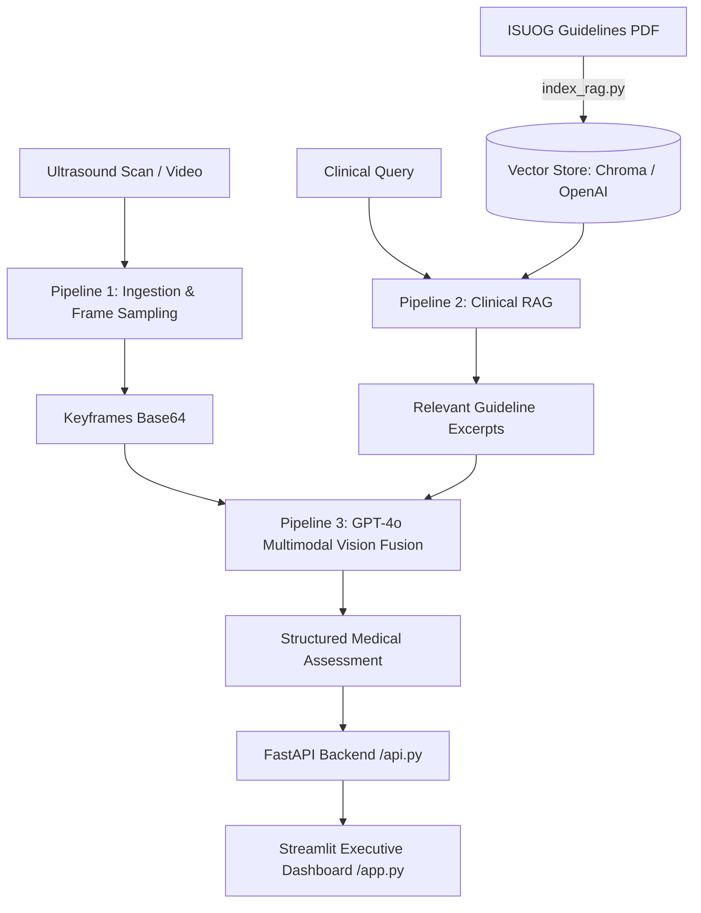

# EchoAI – Fetal Ultrasound Intelligence & Pregnancy Support

An executive multimodal medical AI dashboard for fetal cardiac screening and pelvic ultrasound analysis, grounded in the **ISUOG 2023 Practice Guidelines** and powered by **GPT-4o Multimodal Vision** with **Retrieval-Augmented Generation (RAG)**.

---

## 🌟 Key Features

- **Multimodal Video & Image Ingestion (Pipeline 1)**:
  - Supports ultrasound cine-loops (`.mp4`, `.avi`, `.mov`) and still scans (`.png`, `.jpg`, `.jpeg`).
  - Intelligent keyframe selection using variance-of-Laplacian blur filtering and uniform sampling.
- **ISUOG 2023 Clinical RAG (Pipeline 2)**:
  - Indexed official ISUOG Practice Guidelines for fetal cardiac screening.
  - Hybrid vector store support: native OpenAI Vector Store (production) or local ChromaDB (offline/development).
  - Clinical query expansion and strict guideline citation retrieval.
- **Diagnostic Fusion & Grounding (Pipeline 3)**:
  - Fuses extracted ultrasound keyframes with retrieved clinical literature into a structured prompt.
  - Generates structured medical reports (anatomical view identification, anatomical checklist, anomalies, recommendations, and ISUOG citations).
  - Multi-turn conversational chat for follow-up clinical inquiries.
- **Executive Frontend Dashboard**:
  - High-performance, modern medical dark-mode UI built with Streamlit.
  - Multi-tab report view, keyframe carousel, citation inspector, and session management.
- **FastAPI Production Backend**:
  - Asynchronous, clean REST API endpoints for analysis, chat turns, citations, and health probes.

---

## 🏗️ System Architecture



---

## 📋 Prerequisites

- **Python 3.10+**
- **OpenAI API Key** with GPT-4o access

---

## 🚀 Getting Started

### 1. Clone the Repository

```bash
git clone https://github.com/vis-hal-git/EchoAI-Pregnancy-Support-Ultrasound-Intelligence.git
cd EchoAI-Pregnancy-Support-Ultrasound-Intelligence
```

### 2. Set Up Virtual Environment

```bash
# Windows
python -m venv venv
.\venv\Scripts\activate

# Linux / macOS
python3 -m venv venv
source venv/bin/activate
```

### 3. Install Dependencies

```bash
pip install -r requirements.txt
```

### 4. Configure Environment Variables

Copy `env.example` to `.env` and insert your OpenAI API Key:

```bash
cp env.example .env
```

Edit `.env`:
```env
OPENAI_API_KEY=sk-...
OPENAI_VECTOR_STORE_ID=   # Optional: leave empty to use local ChromaDB
API_URL=http://localhost:8000
GPT_MODEL=gpt-4o
DEFAULT_K_FRAMES=8
```

### 5. Build Knowledge Base (Optional if ChromaDB is pre-indexed)

To build or refresh the local vector store using the included ISUOG guidelines:

```bash
python index_rag.py --pdf "Ultrasound in Obstet   Gyne - 2023 - Carvalho - ISUOG Practice Guidelines  updated   fetal cardiac screening.pdf" --backend local
```

---

## 🖥️ Running the Application

Running the application requires launching the backend and frontend in separate terminals:

### Terminal 1: Backend API (FastAPI)

```bash
# Activate virtualenv first if not activated
.\venv\Scripts\activate

uvicorn api:app --reload --port 8000
```
- API Base: `http://localhost:8000`
- Swagger UI / Interactive Docs: `http://localhost:8000/docs`
- Health Check: `http://localhost:8000/health`

### Terminal 2: Frontend Dashboard (Streamlit)

```bash
# Activate virtualenv first if not activated
.\venv\Scripts\activate

streamlit run app.py
```
- Open your browser at `http://localhost:8501`

---

## 📡 API Endpoints

| Method | Endpoint | Description |
| :--- | :--- | :--- |
| `POST` | `/analyze` | One-shot analysis with ultrasound image/video upload and clinical query |
| `POST` | `/chat` | Multi-turn conversational follow-up on an active session |
| `GET` | `/session/{sid}/citations` | Retrieve RAG guideline citations for a given session |
| `GET` | `/health` | API health check and liveness probe |

---

## 🛡️ Disclaimer

This software is for investigational, research, and educational purposes only. It is not intended to replace formal clinical diagnosis or the medical judgment of qualified sonographers, obstetricians, or maternal-fetal medicine specialists.
